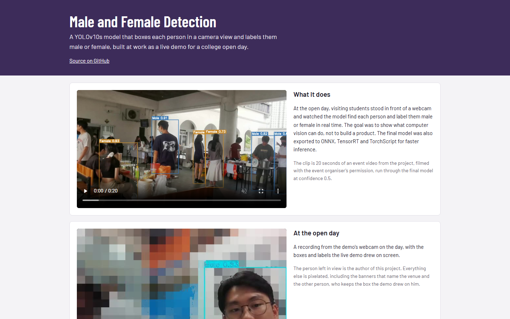

# Male and Female Detection (YOLOv10)

**Live page: https://weikang14.github.io/male-female-detection/**

A YOLOv10s model that boxes each person in a camera view and labels them male or female, built at work as a live demo for a college open day. Four labelled datasets were merged, 43 models were trained over two months, and the final model is scored here on test photos that never appear in its training or validation data.



## Background and goal

At the open day, visiting students stood in front of a webcam and watched the model find each person and label them male or female in real time. The goal was to show what computer vision can do, not to build a product. The final model was also exported to ONNX, TensorRT and TorchScript for faster inference.

## Dataset

Four sets of photos were labelled with two classes, female and male, in Roboflow during September and October 2024, then merged into one dataset: 2,985 training photos, expanded to 10,784 images with augmented copies, plus 952 validation and 696 test photos. The project also includes a small OpenCV notebook that cuts frames out of recorded video, to collect more photos.

## Results

The final model (`models/male_female.pt`, run `NewGender/Model_1`) is YOLOv10s trained from scratch on the merged data. `tools/build_site_data.py` scores it on the 601 test photos that are in neither the training nor the validation split (689 women and 397 men labelled):

| | Precision | Recall | mAP50 | mAP50-95 |
|---|---|---|---|---|
| Both classes | 0.823 | 0.820 | 0.868 | 0.691 |
| Women | | | 0.911 | 0.746 |
| Men | | | 0.826 | 0.637 |

At confidence 0.5 the model found 862 of the 1,086 labelled people and gave 833 of those the right label. It labelled 11 women as male and 18 men as female, and drew 67 boxes where no person was labelled.

## What the training logs show

There were 43 training runs between 2024-09-19 and 2024-11-15, each scored on its own dataset's validation photos. Scores from different datasets cannot be compared with each other, so these points compare runs on the same data.

- **On the merged data, starting over beat continuing.** The runs that continued from the earlier model on the merged dataset peaked at 0.755 validation mAP50. A fresh run from scratch on the same data reached 0.858 and became the final model. Two later runs that continued from it scored 0.857 and 0.845, no better.
- **Training on from a finished model added nothing.** 5 of the 32 runs that started from an earlier model's weights scored best at epoch 1 or 2, then trained about 100 more epochs without improving until early stopping (patience 100) ended them.
- **Merging datasets leaked test photos.** The four sets were split into training, validation and test photos on their own, then merged. 95 of the 696 merged test photos also sit in the training or validation split, so a score on all of them would be too high. The results above leave them out.

Every run is listed on the page and in `training_results/`.

## Limitations and next steps

The model guesses gender from appearance and knows only two labels, so it will mislabel people whose appearance does not match how they identify. It was built to demonstrate object detection, not to decide anyone's gender. The test photos come from the same sources as the training photos, so accuracy on a new camera is likely lower. Each frame is labelled on its own, so a person's label can flicker from frame to frame.

1. Split training, validation and test photos by source photo after merging datasets.
2. Track each person across frames and keep one label per person, so labels stop flickering.
3. Label footage from the demo camera itself and measure accuracy there, for women and men separately.

## The two clips

The event clip was filmed with the event organiser's permission and is shown as the model labels it. The open-day clip is a recording from the demo's webcam with the live boxes already drawn on it; only the author and those boxes are left sharp, and everything else, including another person and the banners that name the venue, is pixelated. The raw videos and photos are not in this repository.

## Who built what

- **weikang14, as a project at work:** labelling the datasets and training every model. The company is not named here.
- **Built with [Claude Code](https://claude.com/claude-code), an AI coding assistant:** this page, scoring the final model on the clean test photos and preparing the two clips (`tools/build_site_data.py`).

## Repository layout

```
models/male_female.pt        final model (YOLOv10s)
training_results/<run>/      args and metrics per epoch of every run, plots of the final one
tools/build_site_data.py     scores the final model, lists every run, renders the two clips, writes web/data/
tools/serve.py               local static server (supports video seeking)
web/                         the page (plain HTML, CSS and JS)
tests/                       checks that this README matches web/data/site.json
```

## Run it

```
python tools/serve.py        # then open http://127.0.0.1:8765
```

Rebuilding the site data needs Ultralytics 8.3 or newer, a CUDA GPU, ffmpeg, and the training folder and video (not in this repository):

```
python tools/build_site_data.py --project path/to/training/folder --video path/to/event.mp4 --open-day path/to/webcam.avi
python -m pytest tests
```

Label people in your own video with the final model:

```
yolo detect predict model=models/male_female.pt source=your_video.mp4 conf=0.5
```
